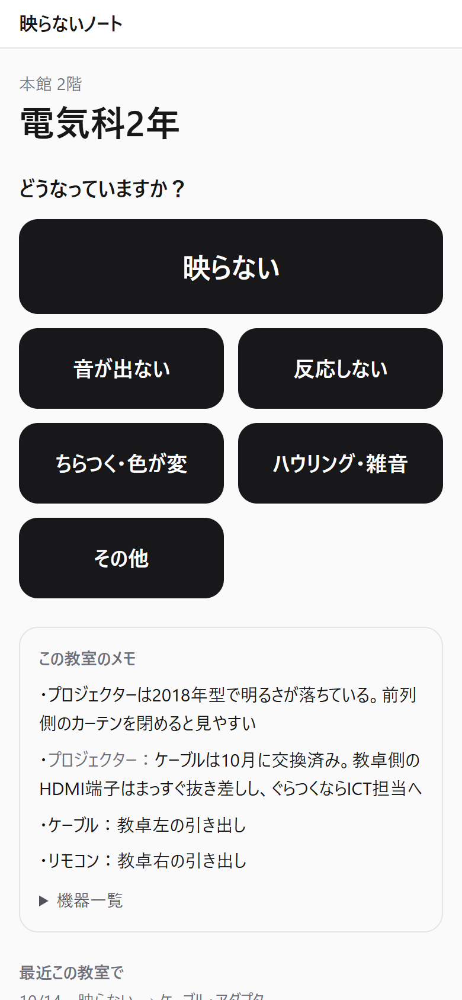
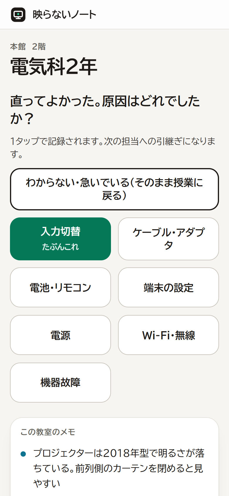
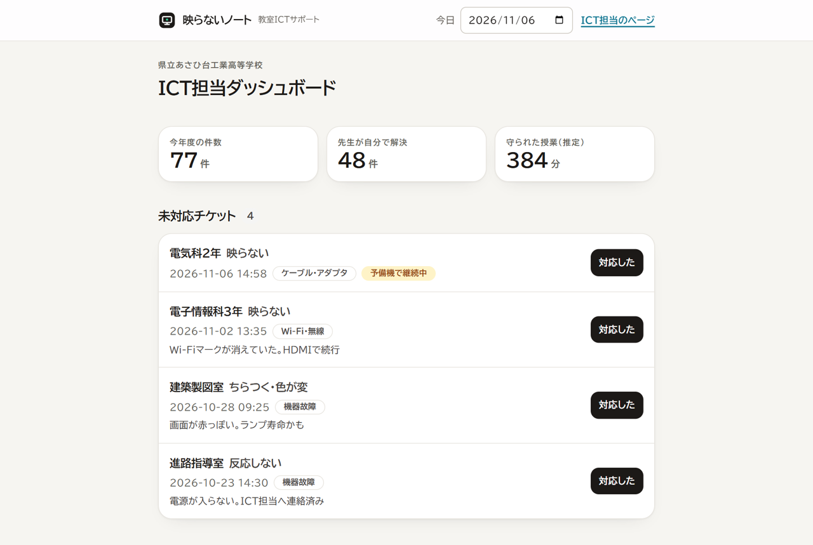

# 映らないノート — 教室ICTサポートエージェント

> 教室で「プロジェクターが映らない」が起きたとき、**その教室の機器を知っているエージェント**が先生の一次対応を助け、直した瞬間の1タップが**次のICT担当への引継ぎ**として自動的に溜まっていく。

Built with Claude: Japan 2026 提出作品（テーマ1「あなたにしかない深さを。」）

- デモ動画（3分・日本語・YouTube）：https://youtu.be/B1mAeMapDzo
- 公開URL：準備中（公開手順と公開前チェックは `docs/DEPLOY.md`）
- 3分で見るなら：`docs/DEMO.md` の台本と、下の画面写真

---

## 誰の、どんな困りごとか

校内ICT担当が教室の機器トラブルで呼ばれるのは、月に3回ほど。授業中に呼ばれ、自分の授業を止めて駆けつけ、数分で直して戻る。中身は入力切替の番号違い、ケーブルのコネクタの傷み、電子黒板の無線が切れていた、の繰り返しです。

数字の外側に、もっと多くのトラブルがあります。先生が自分で直して終わるもの、あとから「実はこの前も」と事後報告されるもの。新しい機器が入った年は、いっせいに増えます。**どれも小さすぎて、誰も記録しません。** 知識は担当者の頭にだけ残り、異動と同時に学校から消えます。次の担当は、同じ1年をやり直します。

| 困っている人 | 場面 | 失うもの |
|---|---|---|
| 呼ぶ先生 | 授業開始直後、大型提示装置が映らない | 授業の5〜10分、生徒の前での焦り |
| 生徒 | その教室 | 年間で積み上がる授業時間 |
| ICT担当 | 自分の授業中に呼ばれる | 自分の授業の中断 |
| 次のICT担当 | 4月の着任 | 1年ぶんの学習のやり直し |

対象は教室の大型提示装置まわりに絞っています。生徒端末のトラブル（パスワード忘れなど）は件数こそ多いものの個人情報を伴うため、本作では扱いません。

**作っているのは、校内ICT担当の本人です。** 県立の工業高校で情報系の学科を教えながら、教室の機器トラブルの一次対応を引き受けています。日本の公立学校では教員が数年ごとに学校を異動し、校務分掌も年度ごとに替わります。ICT担当も「たまたま詳しい人」が兼務で引き受け、異動と同時にその学校の知識がいなくなる。これは一校の事情ではなく、全国の学校で毎年4月に起きていることです。

## 画面

| 先生のスマホ（教卓QRから） | 直ったら原因を1タップ | ICT担当のダッシュボード |
|---|---|---|
|  |  |  |

## 何をするか

1. **教室の一次対応** — 教卓のQRコードから教室ページへ。症状を1タップ。エージェントは最大2問だけ聞き、その教室の機器に合わせた手順を3行以内で返す（「HDMI2に切替。ケーブルは教卓右の引き出し」）。
2. **1タップ記録** — 直ったら原因を1タップ。文章は書かない。直らなければ予備機を案内し、状況つきでICT担当に知らせる。
3. **ICT担当ダッシュボード** — 未対応チケット、原因の内訳、繰り返す教室、ランプ寿命、保守期限、「守られた授業分数」。
4. **確認ポイントの提案と承認** — 履歴から Sonnet が「教室のメモに載せる1行」を提案（「HDMI端子が3つ。挿した番号と入力切替を合わせる（今年度6件中5件）」）。ICT担当が承認したものだけが先生に見える。却下は記憶され、再提案されない。
5. **書類の下書き** — 引継ぎ文書・備品購入計画・修理依頼文。日付を年度末に進めて「引継ぎ」を押すと、1年分の記録・確認ポイント・業者・予備機・行事が次の担当向けの文書になる。引継ぎファイルは書かない。
6. **直らないときの写真1枚** — 引き継ぎ画面でだけ、機器の写真を見てもらえる（ランプ・ケーブル・画面表示）。写真は保存せず、所見の文章だけがチケットに残る。
7. **教卓QR** — 全教室ぶんのQRカードをA4で印刷（`/admin/qr`）。

## 設計で大事にしたこと

- **AIが止まっても成立する** — 教室ページの「この教室のメモ」は静的。APIが落ちても手順集（playbook）の手順をそのまま返す。
- **生徒の個人情報を持たない** — 扱うのは教室・機器・症状・対応だけ。だから今すぐ本物の学校で使える。
- **人が読めるデータ** — 台帳・手順・履歴はリポジトリ内のJSON。Excelに戻せる。ベクトルDBは使わない（1校ぶんは数万トークンに収まる）。
- **先生は30秒しか待てない** — 一次対応は Haiku、分析と文書生成は Sonnet。返答はツール呼び出しで構造化し、画面はボタンだけで進む。質問は「はい／いいえ」で答えられる形に限る。
- **数字はコードが出す** — 件数・時間帯・ランプ寿命は集計コードで確定させ、AIは言葉にするだけ（`src/lib/agent/facts.ts`）。文書の数字が記録と食い違わない。

## 動かし方

確認した環境：Node.js 24、Windows 11（Next.js 16 / TypeScript / Tailwind v4 / zod / Anthropic SDK）。

```bash
npm install
cp .env.example .env.local   # ANTHROPIC_API_KEY を入れる（空でも動く：手順集モード）
npm run dev                  # http://localhost:3000
```

- `.env.example` は項目名だけで値は空。実際のキーは `.env.local` にだけ置く（`.env*` は git 管理外）
- API キーはサーバー側（`src/lib/llm/client.ts`）でしか読まず、ブラウザには届かない
- 校内の LAN で使う前提で、ログインは無い。公開 URL で動かすときは `docs/DEPLOY.md` の「公開前チェック」を通す（API ルートは IP ごとの回数制限つき）

- `/` 教室一覧（本番では教卓のQRから `/room/<id>` へ直接）
- `/admin` ICT担当ダッシュボード（`/admin/docs` 書類、`/admin/qr` 教卓QR）
- ヘッダーの「今日」で日付を動かせる（デモ用。年度末の引継ぎ生成などに使う）

データは架空の **県立あさひ台工業高等学校** のものです。登場する人物・業者・機種はすべて架空です。

## Claude / Claude Code をどう使ったか

- **開発**：Claude Code を中心に構築。`CLAUDE.md` に用語・データの約束・返答方針を固定。
- **サブエージェント**：`.claude/agents/data-author.md`（架空校データの生成）、`.claude/agents/hurry-reviewer.md`（急いでいる先生の視点でUI点検）。
- **フック**：`data/*.json` を書いた直後にスキーマ検証（`.claude/settings.json`）。git の pre-commit で連絡先・APIキー・禁止語を検出。
- **実行時**：
  - `src/lib/agent/triage.ts` — 一次対応。Haiku 5.5、ツール呼び出しの強制で構造化返答、プロンプトキャッシュ、playbook フォールバック。応答 1〜2 秒
  - `src/lib/agent/facts.ts` — 事実パック。履歴・台帳をコードで集計し、AIには集計結果だけを渡す（数字を作らせない）
  - `src/lib/agent/patterns.ts` — 確認ポイントの提案。Sonnet 5.5 ＋ 構造化出力（zod スキーマ）。承認・却下は人
  - `src/lib/agent/documents.ts` — 文書生成。Sonnet 5.5 のストリーミング（長考を抑えて最初の1行を2秒で出す）、事実パックをキャッシュ。APIキーが無ければ同じ事実から雛形を組む
  - `src/lib/agent/photo.ts` — 写真の補助判定。Sonnet 5.5 の画像入力＋構造化出力。写真は保存しない
  - モデルは用途で使い分け（`src/lib/llm/client.ts`）。ここだけ差し替えればローカルLLMに移せる
- 経緯と判断は `docs/DECISIONS.md`、日ごとの作業は `docs/BUILD_LOG.md`、仕様は `docs/SPEC.md`、デモ台本は `docs/DEMO.md`、公開手順は `docs/DEPLOY.md`、提出文面は `docs/SUBMISSION.md`。

## 構成

```
data/            架空校の台帳・手順・履歴（JSON）
src/lib/schema.ts  スキーマの正（zod）
src/lib/store.ts   JSONの読み書き
src/lib/llm/       LLM呼び出しの唯一の入口（ローカルLLMへの差し替え口）
src/lib/agent/     一次対応エージェント
src/app/room/[id]  教室ページ
src/app/admin      ICT担当ダッシュボード
scripts/           データ検証、フック
```

## 次にやること（ハッカソン後）

- 実際の学校で4月から使う。台帳は手元の Excel から取り込む（F7）
- 夜間に「確認ポイントの提案」と週報を作る常駐エージェント（Managed Agents）
- 一次対応・文書生成をローカルLLMに差し替える口はすでに `src/lib/llm/` に閉じてある

## ライセンス

MIT（`LICENSE`）
